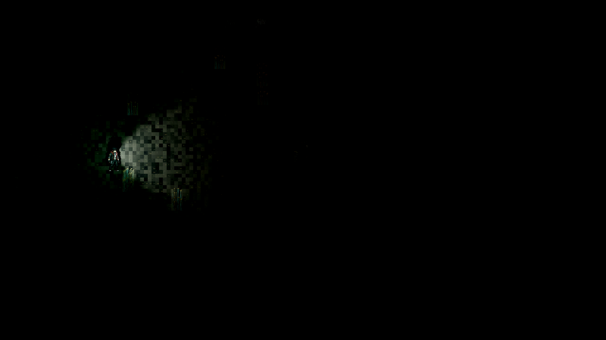
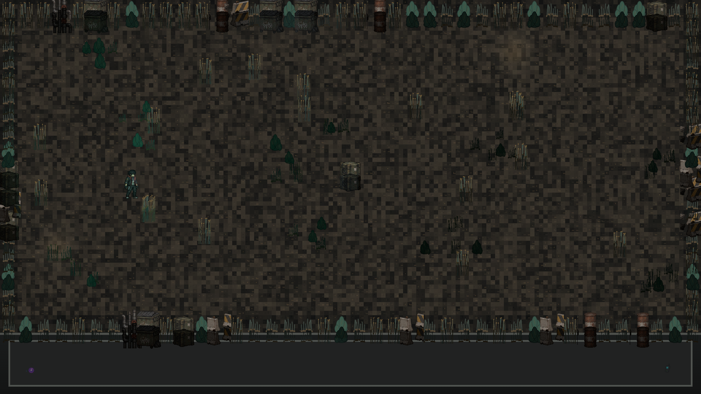
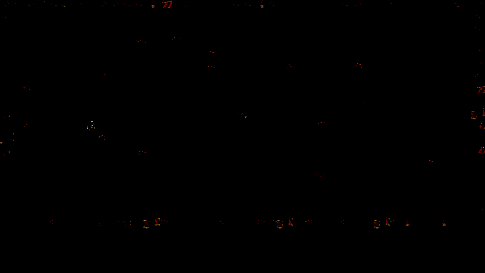

# SM-505 source-separated overnight evidence

Current acceptance remains **BLOCKED**. No physical performance/release acceptance,
Auto promotion, merge or issue closure is claimed.

Additional checkpoints after the first diagnostic:

| Source/configuration | Evidence | Result/limit |
| --- | --- | --- |
|0a432bc/developmentv1|[Receiver originals](receiver-0a432bc-development-v1/README.md)|12receiver checksPASS; user rejected overlybroad/bright inspection; visualFAIL|
|b5f5817/developmentv2|[Native originals](native-b5f5817-development-v2/README.md)|Receiver+streamed numericcontrolsPASS; duplicateprops and distantnoiseFAIL|
|0de5890/developmentv2|[Native originals](native-0de5890-development-v2/README.md)|141anchoredobjects0outside/0below; user confirms no doubledoutlines; distantnoiseFAIL|

[User annotated feedback](user-feedback/feedback.json) and
[exact-capture prop review](user-feedback/human-review-0de5890-props.json) retain
the scope of human judgments. WebGPU must provide higher visualquality; matching
WebGL2 shadow sizes/proportions/output is not acceptance.

Every new checkpoint has its own original ZIP/source/report/telemetry and does
not replace the old attempts. The campaign manifest covers all published files,
including original per-attempt manifests inside/alongside the preserved archives.
GPU execution timings remain NOTRUN in these diagnostics.

## Historical first checkpoint (9b5b932)

# SM-505 source-separated evidence — 2026-10-30T23:47:07Z

**Visual gate FAIL. Physical release/performance acceptance is false.**

[Engineering report](../../../docs/SM505_OVERNIGHT_2026-10-30.md)
contains the exact scope, source/hardware identity, repaired defects and NOT RUN matrix.

- [Final native report, source 9b5b932](physical-9b5b932/report.json)
- [Final pixel-equation analysis](analysis/final-post-analysis.json)
- [Source-separated comparison](analysis/source-separated-comparison.json)
- [Final watchdog/telemetry](physical-9b5b932-guard/guard.json)
- [Telemetry interpretation](analysis/final-telemetry-summary.json)
- [Frozen core gate](frozen-candidate/core-checks.json) and [clean extraction](frozen-candidate/clean-package.json)
- [Original integrated failures](integrated-baseline/core-checks.json)
- [Original failed native attempt](physical-prefix-ca60b95/report.json)
- [Original software-adapter failure](software-observer-smoke/report.json)
- [Full original evidence ZIP](originals/run-evidence.zip), including every original raw .bin, PNG, log, telemetry, partial attempt, source fingerprint and analysis/check report except the separately retained/reconstructable source archive
- [Custody](custody.json), [source equivalence](source-equivalence.json), and [SHA-256 manifest](SHA256SUMS.txt)

The original local run remains at `C:/steelmoth/artifacts/sm505-20261030T234707Z/`.
The 110,549,794-byte pre-fix source archive and its extracted source remain there;
its exact Git source is preserved as commit `ca60b9546e426d9caa5ac6fc05909a733571fbe2`.
They are not duplicated in this Git evidence package. Different executable heads
have distinct reports and are never pooled. Tooling `mock-*` transport artifacts
inside the original archive are explicitly synthetic, not game screenshots.

This package preserves the first native checkpoint, before the subsequent background-receiver repair. Black fraction alone is not a grading-failure criterion; the missing floor lighting is established separately. [Reproduced CPU analysis](analysis/reproduced-final-post.json) and [floor issue criteria](analysis/floor-issue-criteria.json) are additional original analyses published directly.

The native diagnostic uses normal index.html bootstrap plus the existing
deterministic harness/fixture adapter. Captured depth is an rgba8 ownership-debug
replay, **not** full depth32float readback. Diagnostic post replay/observer work
is excluded from all performance claims. No GPU timing campaign was run.

## Matched final-source captures

WebGL2 reference:

WebGPU linear pre-post scene, IEC sRGB encoded for inspection:

WebGPU browser-presented final frame — failed visual gate:

