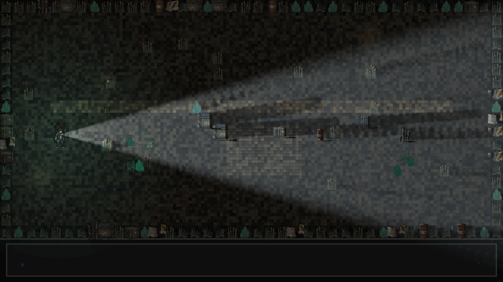

# GTX 1650 SUPER diagnostic: source 62e7856, development inspection v2

**Diagnostic PASS; complete visual/performance/release acceptance BLOCKED.**

Exact source `62e7856cf1dca1d0b21d0f1301260ab1a6ffcc88`, tree
`bf4a123b8504581cba812db30c30afc46b684e4f`; runtime and observer hashes unchanged.
Actual local GTX1650SUPER4096MiB, driver616.92, Chrome156.0.8078.74,
1920x1080/DPR1/Medium/GTAOoff, normal index.html + dense-mixed fixture.
Inspection v2: ambient0.18/full cone35degrees/range900/intensity6, neutral
diagnostic grade through canonical post; production artistic defaults unchanged.

[Checkpoint JSON](checkpoint.json), [original report](report.json),
[guard](guard-guard.json), [telemetry](guard-telemetry.jsonl).
[Originals ZIP](originals.zip) contains all138 native attempt files, complete
original guard, source137-check/clean60-check outputs, and the separate failed
CLI launch (timeout rejected before any browser/GPUwork). Every original .bin,
PNG, injected observer payload, log and original per-attempt SHA manifest is
retained. Extract to verify the original manifests; direct copies aid review.
Do not combine different source datasets. The campaign manifest covers all
published bytes, including the ZIP.

Results: receiver12/12, per-light visibility5/5, reconstruction11/11,
synthetic emissive14/14, lifecycle39/39 PASS. Static anchored raster141objects,
0outside frame/0at-below foot. Reconstruction full-field CPU error0.000488258
(tol0.001), occlusion mass drift0.01858% (tol0.1%), distant floor HFpower
11820.831751 ->321.508154 (97.2802%reduction; target50%). Near14250 and
outside-support1171514 samples remain exactly unchanged. These metrics do not
provide human visual acceptance. Residual distant stippling/broad shadow bands
remain a review concern. The user confirmed no duplicate outlines in source0de;
latest reconstruction review **FAIL**: "They look a bit too weak/blurry now."
[Exact-image review and hash](human-review.json) records this human criterion.
Noise reduction alone is insufficient; detail/strength retention needs repair. WebGL2 shadow sizes/output are not a
quality target.

Lifecycle covers2backend roundtrips,1280x720->1920x1080 recreation/retirement,
and controlled presenter failure with WebGL2 fallback. Actual device loss,
room/editor undo-redo, normal-game emissive material coverage, Firefox physical,
full visual corpus, soak/leak and all GPU performance sampling remain NOTRUN.
No timings are inferred from213.442seconds diagnostic host duration. Telemetry
31-34C,5.07-22.23W; no thermal trip/driver setting changes. Fullqualification
and unchanged12msmean/14.5msp95targets remain unmet.

Reconstructed original browser capture:

Same-source raw-self negative visual control:

